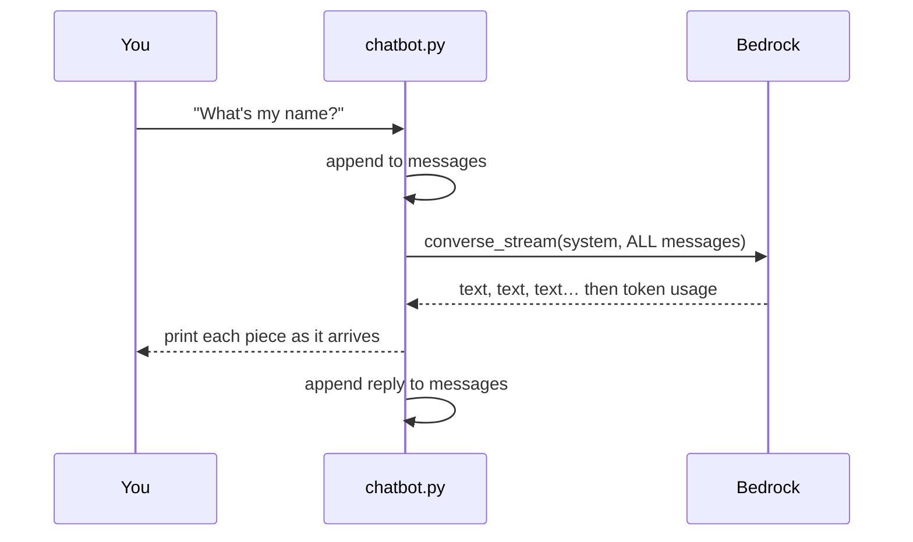

# Amazon Bedrock Nova Chatbot

A small command-line chatbot for [Amazon Nova](https://aws.amazon.com/nova/)
models on [Amazon Bedrock](https://aws.amazon.com/bedrock/), written to be read.
The whole program is one file, [`chatbot.py`](chatbot.py): about 300 lines,
roughly half of them comments, arranged as a numbered walkthrough.

It streams replies as they're generated, and lets you switch between Nova
models in the middle of a conversation.

> **Not just Nova.** The code uses Bedrock's Converse API, which has the same
> request shape for most chat models on Bedrock: Anthropic Claude, Meta Llama,
> Mistral and others. Everything here should work with them too; see
> [Using other models](#using-other-models).

## What you'll learn

By reading the code and trying the exercises below you'll be able to:

1. Explain why a chatbot has to resend the whole conversation on every turn.
2. Call a Bedrock model with the **Converse API**, and switch models by
   changing a single string.
3. Stream a reply token by token instead of waiting for all of it.
4. Read model IDs and inference profiles (`us.`, `global.`) and know which to use.
5. Relate token counts, including hidden reasoning, to what you pay.

## The models

| Short name | Model | Good for |
| --- | --- | --- |
| `lite` (default) | Nova 2 Lite | Everyday use. Newest generation; text, images and video; optional step-by-step reasoning (`--think`) |
| `micro` | Nova Micro | Text only. The fastest and cheapest |
| `pro` | Nova Pro | First-generation multimodal model; the most capable of the original Nova models |

Run `uv run chatbot.py --list` to see the exact model IDs.

## Quick start

You need an AWS account, Python 3.12+, and either
[uv](https://docs.astral.sh/uv/) (recommended) or pip.

**1. Get the code**

```bash
git clone https://github.com/scttfrdmn/amazon-bedrock-nova-chatbot.git
cd amazon-bedrock-nova-chatbot
```

**2. Sign in to AWS.** Pick one:

- *Bedrock API key* (simplest): create one in the
  [Bedrock console](https://console.aws.amazon.com/bedrock/home#/api-keys) and
  `export AWS_BEARER_TOKEN_BEDROCK=<your key>`
- *Regular AWS credentials*: `aws configure`, `aws sso login`, or an IAM role.

Nova models are enabled by default, so there's nothing to request.

**3. Run it**

```bash
uv run chatbot.py                 # uv installs boto3 for you
```

or, with pip:

```bash
python -m venv .venv && source .venv/bin/activate
pip install boto3
python chatbot.py
```

Options: `--model micro`, `--think low`, `--region eu-west-1`,
`--system "Answer like a pirate"`, `--list`. While chatting, type `/help`.

## How it works



The model has no memory. The `messages` list *is* the memory, and it travels
with every request. Everything else in the file supports that loop:

| Section in `chatbot.py` | Idea |
| --- | --- |
| 1. Choosing a model | Model IDs, and inference profiles that decide where requests run |
| 2. Connecting to Bedrock | One boto3 client; credentials are found automatically |
| 3. The conversation | Messages alternate `user` / `assistant`, each holding content blocks |
| 4. Asking for a reply | `converse_stream`, the events it sends back, and Nova's reasoning option |
| 5. When things go wrong | Turning AWS error codes into plain advice |
| 6. The chat loop | Reading input, commands, printing the reply |

The smallest possible version, with no history or streaming, looks like this:

```python
import boto3

client = boto3.client("bedrock-runtime")
response = client.converse(
    modelId="global.amazon.nova-2-lite-v1:0",
    messages=[{"role": "user", "content": [{"text": "Hello!"}]}],
)
print(response["output"]["message"]["content"][0]["text"])
```

`chatbot.py` is these few lines plus a list that remembers, a stream, and some
care when things fail.

## Things to try

Before each one, **predict** what will happen, then check.

1. **Memory.** Tell the bot your name, then ask for it. Now type `/clear` and
   ask again. Where did the "memory" go?
2. **Look inside.** After a few turns, type `/history`. This is exactly what is
   sent to the model. Compare it with the example in section 3 of the code.
3. **Cost grows.** Watch the `tokens in` number after each reply. Why does it
   keep rising when your questions are short?
4. **Swap brains.** Start with `--model micro`, ask a question, then
   `/model pro` and ask a follow-up. Pro answers in context, even though Micro
   wrote the earlier replies. What does that tell you about where the
   conversation lives?
5. **Hidden thinking.** Ask a trick question, for example *"A bat and a ball
   cost $1.10 in total. The bat costs $1.00 more than the ball. How much is the
   ball?"* Ask it once normally, then again with `--think low`. Compare the
   `tokens out`: in our test it went from about 10 to about 300 for the same
   one-line answer. The reasoning is hidden, but you pay for it.
6. **Personality.** Run with `--system "You are a terse pirate."`

## Exercises

Small changes, roughly in order of difficulty. Each touches one section.

1. Add Nova Lite (the first-generation model, `us.amazon.nova-lite-v1:0`) to
   `MODELS` and compare it with Nova 2 Lite. *(section 1)*
2. Add `"temperature": 0.2` to `inferenceConfig` and compare answers to a
   creative prompt at `0.2` and `1.0`. *(section 4)*
3. Keep a running total of tokens for the session and print it on exit.
   *(sections 4 and 6)*
4. Show a "thinking…" indicator while `reasoningContent` deltas arrive, so the
   pause with `--think` doesn't look like a hang. *(section 4)*
5. Long chats get expensive. Keep only the last 10 messages when sending.
   What breaks if you cut in the wrong place? *(sections 3 and 4)*

## Using other models

Nothing in `chatbot.py` is specific to Nova except the `MODELS` table and the
`--think` option. To use another Bedrock model, pass its model ID or inference
profile ID:

```bash
uv run chatbot.py --model global.anthropic.claude-haiku-5-5
```

or switch to it mid-conversation with `/model <id>`. Find IDs in the
[Bedrock model catalog](https://docs.aws.amazon.com/bedrock/latest/userguide/model-cards.html).

A few things to know:

- Some providers ask for a one-time sign-up in the Bedrock console before
  first use. Anthropic, for example, has a short use-case form.
- `--think` sends Nova's `reasoningConfig`. Other models turn reasoning on in
  their own way, and some (recent Claude models, for example) reason by
  default. Leave `--think` off for non-Nova models.
- Regional profiles depend on where you are: the first-generation Nova models
  use `us.` in this code, but `eu.` or `apac.` from those regions.
  `global.` profiles work from anywhere.

## Tests

```bash
uv run pytest
```

The tests replace Bedrock with a small fake client, so they run offline and
cost nothing. They're also a compact summary of the behaviour that matters.

## Troubleshooting

The chatbot prints a hint with every AWS error. The common ones:

- **No credentials found**: set `AWS_BEARER_TOKEN_BEDROCK`, or run `aws configure` / `aws sso login`.
- **AccessDeniedException**: your IAM identity needs `bedrock:InvokeModelWithResponseStream`.
- **ValidationException: model identifier is invalid**: the ID is mistyped,
  retired, or regional (`us.`) and you're outside that region. Check the
  [model lifecycle page](https://docs.aws.amazon.com/bedrock/latest/userguide/model-lifecycle.html).
- **ValidationException: reasoning config value is invalid**: `--think` only
  works with Nova 2 Lite.

## License

MIT. See [LICENSE](LICENSE).
